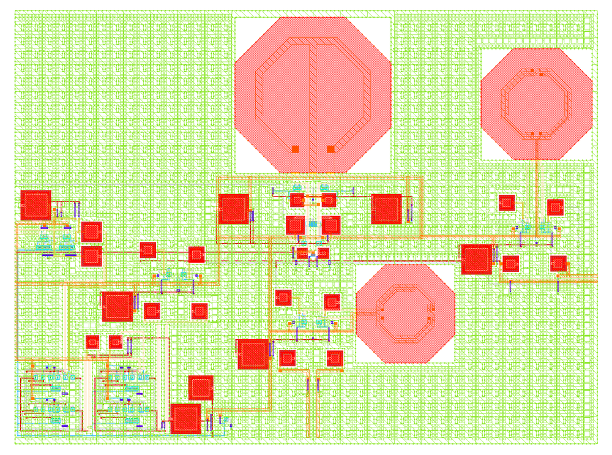
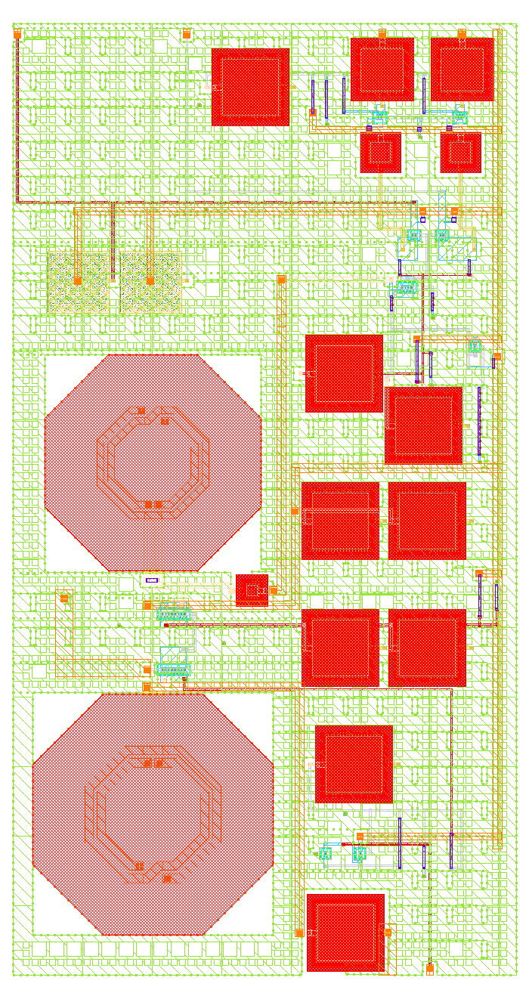
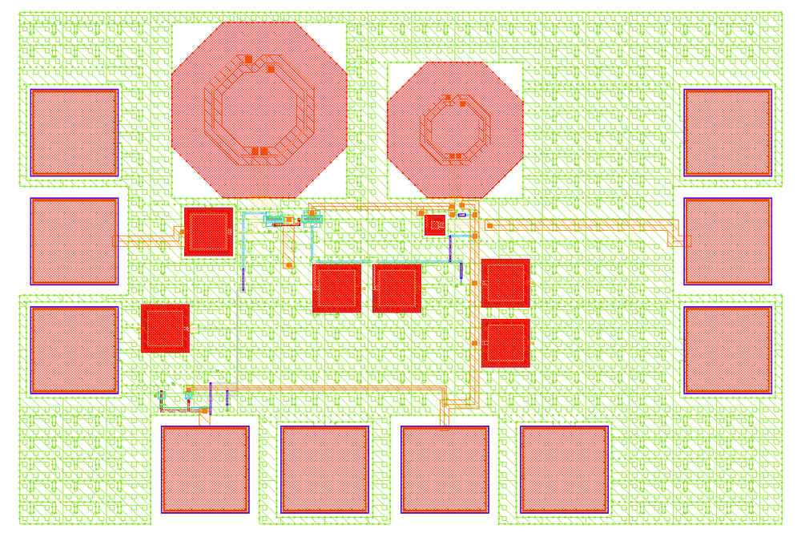
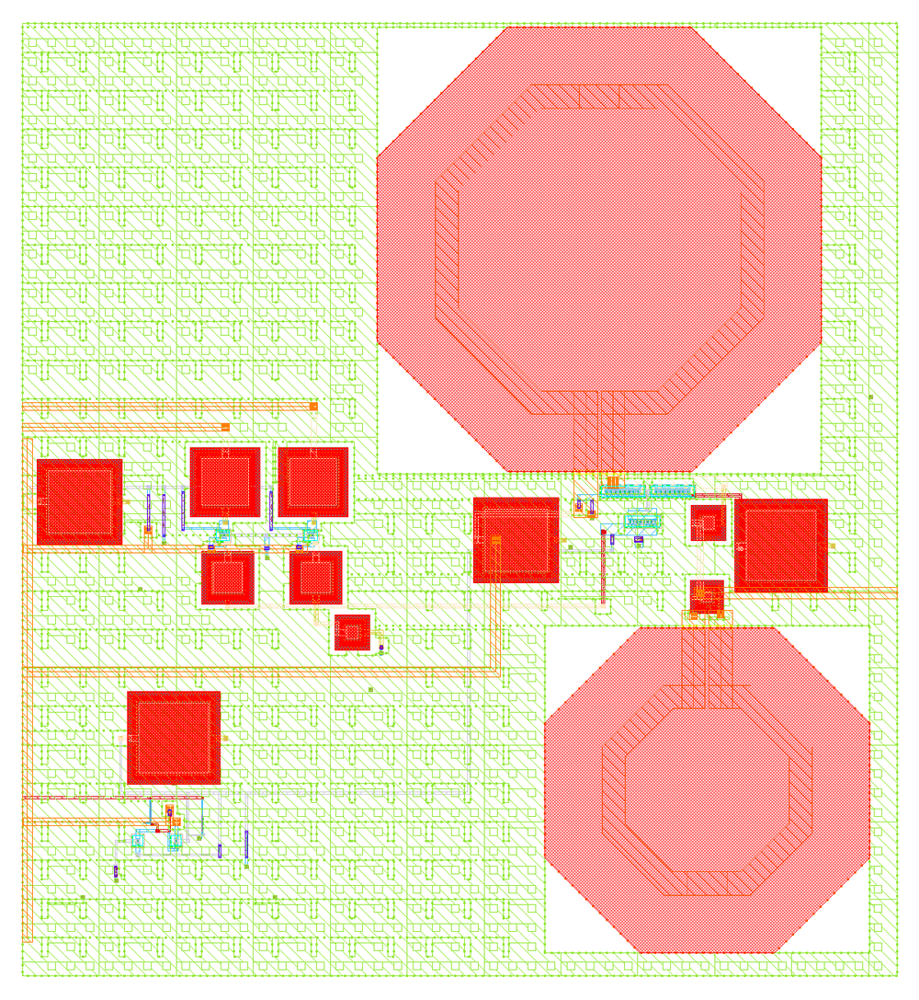
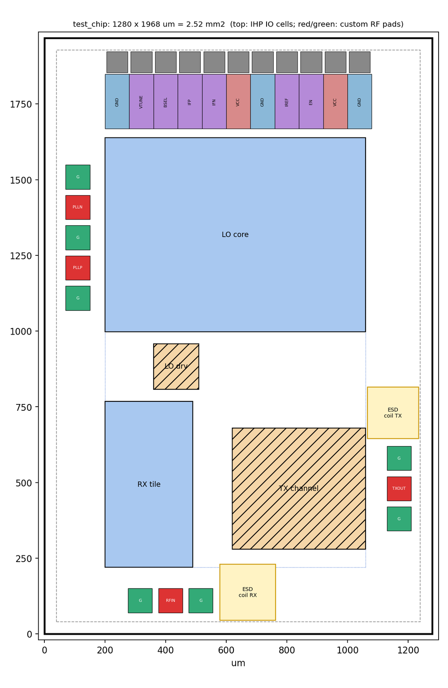
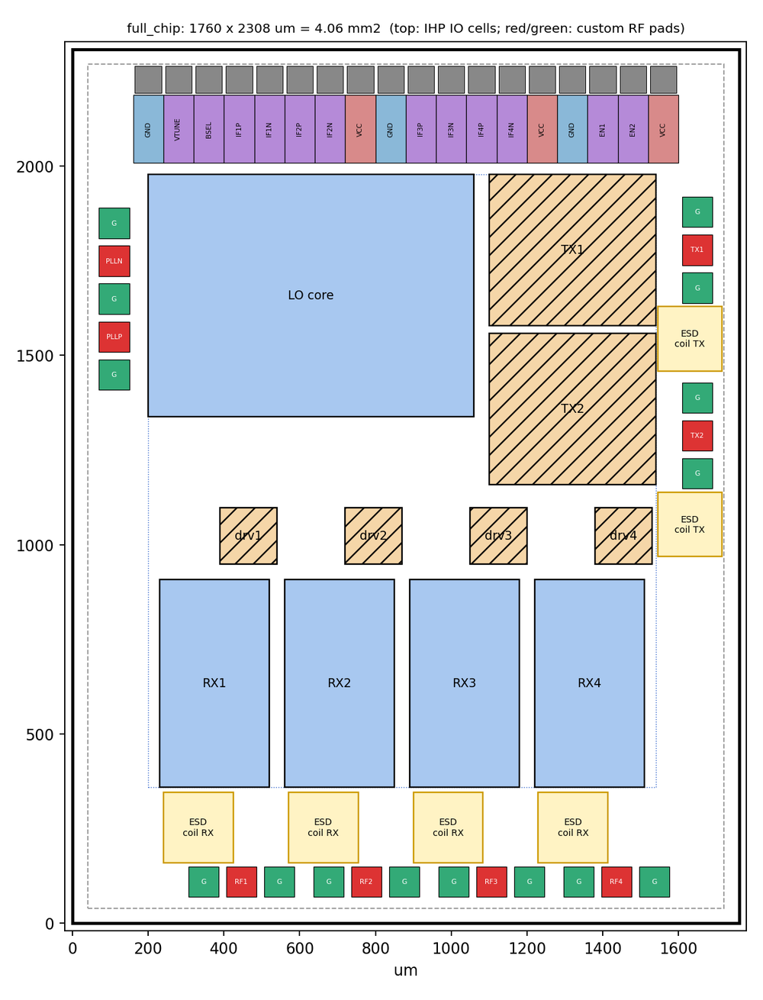
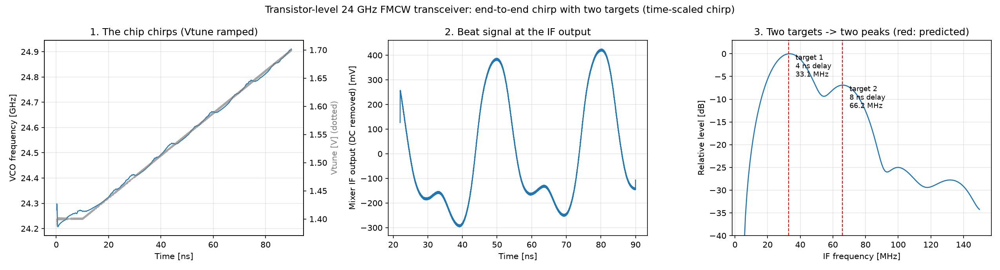

# 24 GHz FMCW Radar Transceiver in IHP SG13G2: an Open-Source Design, Signed Off at Block Level

A **2 TX / 4 RX FMCW phased-array radar transceiver** for the 24.00–24.25 GHz ISM band, designed in IHP's
open-source **SG13G2 130 nm SiGe BiCMOS** process (HBT fT/fmax = 350/450 GHz) and verified with open-source
tools only: ngspice, KLayout, KLayout-PEX and openEMS, inside the IIC-OSIC-TOOLS container.

Every block is taken from schematic to a **signed-off layout**: generated by Python scripts, checked with IHP's own
rule decks (DRC, antenna, LVS), extracted, EM-verified, and re-tuned after extraction across process, voltage and
temperature corners. Assembling the blocks into a full chip is the next phase, left as future work.


*The LO core (860 × 640 µm): VCO tank coil (top centre), TX and RX LO pre-driver coils, MIM capacitors (red)
and the RF-aware cheesed Metal4 ground plane. DRC, antenna and LVS clean with IHP's KLayout decks.*

## Goal and scope

- **Goal:** show how far an open-source flow can take a 24 GHz radar transceiver: from schematic to signed-off,
  post-layout-verified block layouts in IHP's SG13G2 process.
- **End point: block-level sign-off.** All four block types (LO core, LNA, RX channel, TX channel) pass DRC, antenna
  and LVS with IHP's decks and a parasitic-extraction gate, and are verified after extraction at every corner.
- **Floorplans** for two top-level layouts built from the same blocks: a **test chip** (LO core, one RX channel, one TX
  channel; 1280 × 1968 µm, 2.52 mm²) and the **full 2TX/4RX chip** (1760 × 2308 µm, 4.06 mm²).
- **Future work:** chip-level assembly and sign-off (pad cells, LO distribution, seal ring and fill, full-chip DRC and
  LVS, IHP's precheck).
- **Out of scope:** fabrication and production. The antenna PCB and FPGA processing chain are covered by
  system-level models only.

This is an independent student project (M.Sc. Electrical Engineering, TU/e, Semiconductor Devices and
Technology track). It is also a test of how far an open-source flow can go for a millimetre-wave design.

## Status

| Part | Circuit | Layout and sign-off | Post-layout verification |
|---|---|---|---|
| System model and requirements | Done | n/a | n/a |
| LO core (VCO, ÷4 divider, LO drivers) | Done | Done: DRC, antenna, LVS clean | Done: extracted, all corners |
| LNA (stand-alone test structure) | Done | Done: DRC, antenna, LVS clean | Done: extracted and re-tuned |
| RX channel (LNA + mixer) | Done | Done: DRC, antenna, LVS clean | Done: extracted and re-tuned |
| TX channel (driver + PA) | Done (real devices, EM-verified coils) | Done: DRC, antenna, LVS clean | Done: extracted, re-tuned, stable |
| Pads and ESD | Done (IHP IO cells + EM-verified RF ESD coils) | Future work (pad cells) | Future work |
| LO distribution to 4 RX channels (full chip) | Schematic level | Future work | Future work |
| Floorplans of both chips | Done, built from the real cells | n/a | n/a |
| Chip-level assembly and sign-off | Future work | Future work | Future work |

## Results

Post-layout (extracted) results across corners from slow (85 °C, VCC −5%) to fast (−40 °C, VCC +5%); "typical"
values span the extraction bounds described under [Verification](#verification).

| Block | Key results |
|---|---|
| **LO core** | VCO covers 24.00–24.25 GHz at every corner (worst-case band edges 23.07 and 24.86 GHz); PLL output ≥ −7.1 dBm; LO drive at the RX mixers ≥ 0.25 V (specification 0.25 V); 128–145 mA |
| **LNA** | Gain 20.0–20.7 dB; NF 2.44–2.52 dB; S11 ≤ −21 dB; S22 ≤ −11.7 dB (with ESD coils); unconditionally stable (K ≥ 17) |
| **RX channel** | Conversion gain 22.2–26.9 dB; NF 2.30–2.46 dB typical (about 2.8 dB at 85 °C); input match better than −14 dB |
| **TX channel** | After layout: +6.1 dBm typical, +3.7 dBm at 85 °C and VCC −5% (2.6–4.6 dBm across the substrate bracket); 2nd harmonic ≤ −19.5 dBm; unconditionally stable 0.1–100 GHz; 19.6 mA. Details in [`tx/`](tx/README.md) |
| **ESD** | IHP IO cells (diodes, RC supply clamps) on all DC pads; inductive ESD on RF pads, ≈ 0.05–0.07 dB NF cost on RX |

<p align="center">
  
  &nbsp;&nbsp;
  
  &nbsp;&nbsp;
  
</p>
<p align="center"><em>RX channel tile (290 × 548 µm), the stand-alone LNA test structure with its pads (700 × 470 µm), and the TX channel (455 × 495 µm).</em></p>

## Verification

Every block goes through the same automated sign-off flow (`signoff/`):

- **Physical sign-off** with IHP's KLayout decks: DRC (main and maximal rule sets), antenna and LVS. Metal4
  density reduced from up to 72% to 51–54% (IHP maximum 60%) by RF-aware cheesing of the ground plane.
- **Parasitic extraction** with KLayout-PEX. Because the extractor treats the substrate as an ideal ground,
  each RF block is verified at a lower and an upper bound of the extracted capacitance, and both must pass.
- **EM simulation** of every inductor in openEMS, with a path-length topology check that rejects open or
  shorted coils.
- **Corners and stability:** slow/typical/fast HBT, MOS, resistor and MIM corners at −40 to 85 °C and VCC ±5%;
  two-port stability (K, μ) and internal-node impedance scans up to 100 GHz.
- **Extraction gate:** the extractor's own LVS, MIM net integrity and log checks; reviewed findings are recorded
  as waivers with their reasons.

| Inductor (turns, w / d in µm) | Use | EM result at 24.1 GHz |
|---|---|---|
| 1, 10 / 150 (custom, centre-tapped) | VCO tank | 365 pH, Q ≈ 25 |
| 2, 4 / 44 | LNA output | 335 pH, Q 8.1 |
| 2, 5 / 54.5 | RX LNA input | 435 pH, Q 11.3 |
| 1, 12 / 147 | PA output | 333 pH, Q 24.8 |
| 1, 12 / 85 | PA 2nd-harmonic trap | ≈ 170 pH, Q ≈ 20 |
| 2, 7 / 77 | TX pad ESD | ≈ 730 pH, Q 14.8 |
| 3, 5 / 86 | RX pad ESD | 1.48 nH, self-resonant at 23.4 GHz (≈ 2.3 kΩ in band, nearly invisible to the LNA) |

### What the flow caught

| Problem | Effect if it had reached silicon | Fix |
|---|---|---|
| Hand-modelled line capacitance 3–4× too low | VCO at about 21 GHz instead of 24 GHz | VCO redesigned against the extraction |
| IHP's single-turn centre-tapped coil PCell is malformed | VCO coil of 60 pH instead of 365 pH | Custom coil generator plus topology check |
| Coil PCells silently clamp small diameters | Coils larger than designed | Diameter probe before every coil |
| Extracted capacitance detuned the LNA | Gain peak at 20.5–21.5 GHz; RX input match −5 dB | Coils and emitter strip re-tuned |
| High-injection collapse of the high-voltage cascode HBT | PA output +2.4 dBm at the fast corner | Cascode doubled; bias and drive re-tuned |
| Ground plane at 72% Metal4 density; polygons over 8191 points | Rejection at foundry intake | RF-aware cheesing; plane stored as tiles |
| ~83 fF of extracted capacitance on the PA's input path | TX output 3.6 dB low at the hot corner | Input MIM removed, base line rerouted, driver re-tuned (+2.3 dB) |
| A misspelt PCell name silently returns an NMOS transistor | A transistor where a capacitor belongs | Generators refuse unknown cell names |
| The resistor cell silently clamps lengths below 0.5 µm | A resistor different from the simulated one | Legal geometry (2.2 × 0.5 µm) |

## Floorplans

Both chips use a hybrid pad ring: IHP's silicon-proven IO cells for all DC and supply pads along one edge, and
custom GSG pads with EM-verified ESD coils for the RF ports on the other edges. RX inputs and TX outputs sit on
opposite sides for isolation.

<p align="center">
  
  &nbsp;&nbsp;
  
</p>
<p align="center"><em>Test chip (2.52 mm²) and full 2TX/4RX chip (4.06 mm²), drawn to scale from the real cells (<code>floorplan/</code>).</em></p>

## Earlier stage: system model and transistor-level demo

Before layout, the whole chip ran an **end-to-end chirp at transistor level**: the VCO sweeps, the PA transmits,
two simulated targets echo back, and the mixer output shows one beat tone per target at the predicted
frequencies. These results are schematic-level; the system model will be refreshed with the post-layout numbers.



| System parameter (`model/radar_system_model.py`) | Value |
|---|---|
| Band / waveform | 24.00–24.25 GHz, FMCW, 250 MHz bandwidth, 128 µs chirps |
| Range resolution | 0.60 m |
| Max velocity / velocity resolution | 24.3 m/s / 0.38 m/s |
| Detection range, small drone (0.01 m²) / person (1 m²) | 54 m / 171 m |

`model/mimo_scene.py` adds a 2 TX / 4 RX TDM-MIMO scene with an 8-element virtual array and an FPGA-style chain:
range FFT, Doppler FFT, 2-D CA-CFAR, TDM Doppler compensation and angle estimation.

## Repository layout

```
model/        system model (link budget, requirements) and 2TX/4RX MIMO scene
lo_core/      LO core: VCO, ÷4 divider, LO drivers (layout generator, LVS netlists, sign-off)
lna/          LNA: design, EM inductor files and runs (em/), layout and sign-off (layout/)
rx_tile/      RX channel, LNA + mixer (layout generator, LVS netlists, sign-off)
tx/           TX channel, driver + PA (final netlists, testbench, post-layout and stability reproduction)
tx_ch/        TX channel layout: generator, LVS netlists (IHP deck and KLayout-PEX), sign-off
signoff/      sign-off runner, extraction gate, density preview, stability and impedance scans
floorplan/    to-scale floorplans of the test chip and the full chip
phased_chip/  hybrid post-layout model of the LO core and RX path
cdlsim/       post-layout re-tune harnesses
vco/ mixer/ pa/ divider/ lotree/ top/   schematic-level designs and the top-level demo (earlier stage)
docs/         images
```

## Reproduce

Inside IIC-OSIC-TOOLS with `PDK=ihp-sg13g2`:

```bash
cd lo_core/layout && bash run_signoff.sh lo_core     # DRC, antenna, density, LVS, extraction, gate
cd tx && python3 run_tx_final.py                     # TX corners: expects +4.99 / +6.78 / +5.50 dBm
python3 floorplan/floorplan_v2.py                    # floorplans of both chips (from the repository root)
cd model && python3 radar_system_model.py            # link budget and requirement checks
```

## Roadmap

Done (the project's end point, block-level sign-off):

- [x] System model, block designs and corner verification
- [x] LO core, LNA and RX channel: layout, sign-off, extraction, post-layout re-tune
- [x] TX channel circuit with real devices and EM-verified coils
- [x] Pad and ESD strategy; floorplans of both chips
- [x] TX channel: layout, sign-off, extraction, post-layout re-tune and stability check

Future work (chip level):

- [ ] Pad cells: RF GSG pads with ESD coils, IHP IO segment with its rails
- [ ] LO core robustness: third band-select bit, varactor bias, tank-level EM
- [ ] LO distribution network layout (full chip, phase-matched)
- [ ] Top-level assembly of both chips
- [ ] Chip-level sign-off: seal ring, fill, full-chip DRC and LVS, antenna, density, IHP precheck, ESD and electromigration checks

## Limitations

- **Not fabricated.** All results are simulations with IHP's open models, which are not calibrated at 24 GHz.
- **Extraction:** KLayout-PEX treats the substrate as an ideal ground; the design is bracketed between a lower and
  an upper bound of extracted capacitance instead.
- **TX at the hot corner:** +3.7 dBm at the mid-bound meets the +3.5 dBm target; at the pessimistic substrate bound
  it reaches +2.6 dBm. Closing that gap would take a larger redesign (an inductively peaked driver or a two-stage PA).
- **EM:** openEMS simulations of individual inductors; no full-chip EM.
- **Statistics:** Monte Carlo coverage is limited to selected checks (for example LO phase mismatch).

## Tools and acknowledgements

[IHP Open PDK](https://github.com/IHP-GmbH/IHP-Open-PDK) ·
[IIC-OSIC-TOOLS](https://github.com/iic-jku/IIC-OSIC-TOOLS) ·
[ngspice](https://ngspice.sourceforge.io) · [KLayout](https://www.klayout.de) ·
[KLayout-PEX](https://github.com/martinjankoehler/klayout-pex) · [openEMS](https://openems.de)

Licensed under the Apache License 2.0 (see `LICENSE`).
